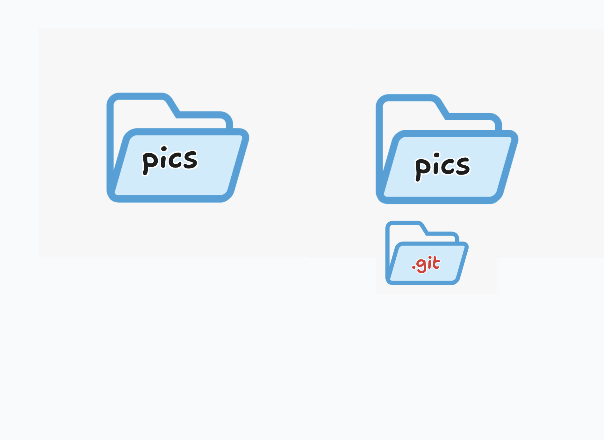

# Introduction to Git and Version Control Software (VCS)

Know this feeling?

You're staring at a folder full of files called something like: 

- `FINAL_PROJECT.doc`,
- `FINAL_PROJECT_last.doc`,
- `FINAL_PROJECT_REALLY_FINAL.doc`, and of course... 
- `FINAL_FINAL_PROJECT_REALLY_THIS_TIME.doc`. 

Insanity.

The same feeling you get when you have to find a PDF attachment in any length of Gmail thread to pick the correct version, trying to find the one attachment that wasn’t “the latest version” even though three people swore it was. 

Never gonna happen.

Version Control to the rescue!

## What's Version Control?

Version Control is software that records every single change, down to the individual line of code or character of text, and stores meta data with it.

## What's meta data?

Quite literally its data that explains other data.

Quite understandably, it's stuff like those notes you left yourself on the `FINAL_FINAL_PROJECT_2.doc` document where you commented something like: *"It would have been the last version of it, but I forgot to Photoshop the stupid bow out of the panda's ear that shouldn't have been there anyways... But now it's clean so we're done!."*

Those kinds of notes help you remember what was going on.

But version control is more than that...

You get a full timeline of your project’s, and every person who made an edit or contribution to the file, the time the did it, what they did, their metadata, etc. 

It makes collaborating with a team (or your just insane self) super easy to manage.

and then... git?

## what's Git?

Git is a software program. Nothing more.

Where people outside of software development often get hung up is that it’s one of those programs that usually isn’t run with a visual interface (also known as a user interface (UI) or graphical user interface (GUI)). 

In other words, there’s no “app to click on” or "screen to do stuff with."

There's no dragging and dropping and button clicky-ing.

So how do you actually use it? Run it? Open it?

By typing commands into the terminal (aka the command line) — that thing that instantly makes you feel like a hacker or Neo from The Matrix.

## How does git work?

What Git does is simple but powerful: it takes any folder on your system (speaking mainly to Mac and Linux users here, though Windows counts too if we brush aside some technical details) and turns that folder into its own little software program (kinda) that can track, at a very granular level, every single edit or change made to it from then on - if you want it to.

Quite literally when you go into a "folder" on your computer and run the thing that makes "git turn on" (we say initialize here), it installs a `.git/` folder in there that starts tracking things. 

That's mostly accurate.

A folder is turned into a "repository" - a "git repository" more specifically (that's just terminology don't get hung up, you'll get used to talking like a smart person too soon)

Quite literally this is the difference between a normal folder, and a git repository:

